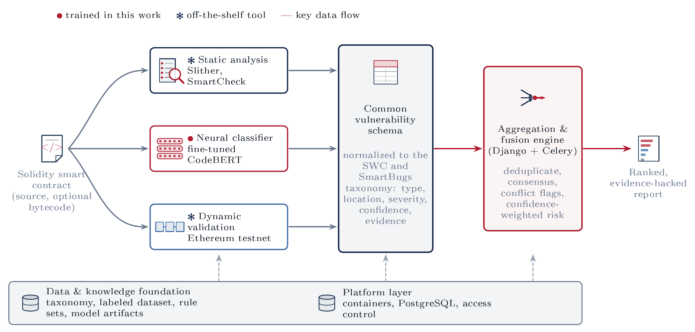

# A Multi-Method Framework for Vulnerability Detection in Ethereum Smart Contracts

**MSc Cybersecurity capstone project report**
Faculty of Computational Sciences and Informatics, Academic City University, Accra

| | |
|---|---|
| Author | Dominic Tomking (2000240027) |
| Supervisor | Dr Siraj |
| Submitted | December 2026 |
| Release used in the report | `v1.0-capstone` (see the Releases page for the commit) |

This repository holds the code, data and results behind the capstone project report. It lets an examiner re-run each
component that the report evaluates and trace every reported number to a file.

## The project in brief

Smart contracts cannot be patched once deployed, so a latent flaw becomes a permanent liability. The project designs and
implements a framework that places four detection engines behind one common vulnerability schema:

* **Slither** and **SmartCheck** (static analysis),
* a fine-tuned **CodeBERT** classifier (learned detection), and
* a **testnet validator** that executes an exploit on a local EVM (dynamic confirmation),

with a versioned ground-truth matching procedure and a confidence-weighted aggregation service that ranks the findings
of all engines in one report.



The evaluation is **component-level**: each engine is evaluated on its own evidence base. Running Slither, SmartCheck
and CodeBERT together on a common contract set through the aggregator and the validator is future work (report,
Section 5.7).

## Repository map

| Folder | What it contains | Report sections |
|---|---|---|
| [`vulnscan-framework/`](vulnscan-framework) | Framework code: common schema, Slither and SmartCheck adapters, aggregation (`vulnscan/aggregation/fusion.py`, risk score Eq. 3.17), ground-truth matching (strict and lenient), testnet validator, Django/Celery orchestration, Docker files, tests | Ch. 3 (3.3, 3.5, 3.6, 3.8 to 3.10), Ch. 4 Part B |
| [`vulnscan-framework/contracts_samples/`](vulnscan-framework/contracts_samples) | The three proof-of-concept contracts (Reentrancy, UncheckedCall, TxOrigin) | 3.4, 4.10 |
| [`vulnscan-framework/fixtures/ground_truth.json`](vulnscan-framework/fixtures/ground_truth.json) | The five pre-specified labels for those contracts | 3.4, 3.10 |
| [`vulnscan-framework/artifacts/`](vulnscan-framework/artifacts) | Saved static-analysis outputs, aggregated report and strict/lenient evaluation | Tables 4.5 to 4.7 |
| [`codebert/`](codebert) | Re-run notebook, the rebuilt function-level dataset, all out-of-fold outputs and the Chapter 4 figures | 3.4, 3.7, 3.11, Ch. 4 Part A, App. C and D |
| [`docs/`](docs) | Architecture and CodeBERT pipeline figures | Figures 3.1 and 3.2 |

## Headline results (as reported in Chapter 4)

**CodeBERT** (993 functions from the 143 SmartBugs Curated contracts; contract-grouped five-fold cross-validation with
duplicate-merged groups, inner-split model selection and three seeds; pooled out-of-fold, mean ± SD over seeds):

| Metric | Majority baseline | Default decision | Nested thresholds |
|---|---|---|---|
| MCC | 0.000 | 0.285 ± 0.056 | 0.304 ± 0.073 |
| Macro-F1, 9 classes (≥5 examples) | 0.101 | 0.321 ± 0.012 | 0.318 ± 0.023 |
| Accuracy | 0.827 | 0.543 ± 0.099 | 0.704 ± 0.124 |

**Static analyzers** on the three proof-of-concept contracts (five labelled findings, identical under strict and
lenient scoring): Slither precision 0.833, recall 1.000; SmartCheck precision 1.000, recall 1.000. These figures come
from five findings and are a demonstration, not an estimate of tool performance.

**Testnet validation** (single case): on `VulnerableBank`, a Solidity 0.8.19 contract with the same
withdraw-before-update flaw as `Reentrancy.withdraw`, the attacker drained the bank's 5 ETH of honest deposits
(`exploit_confirmed`).

## Reproducing the results

**Static analysis, aggregation and matching** (Python 3.11, Java 8, Node 22; see `vulnscan-framework/README.md`):

```bash
cd vulnscan-framework
pip install -r requirements.txt
bash docker/install_solc.sh            # solc 0.4.26, 0.5.17, 0.6.12, 0.8.19
npm install -g @smartdec/smartcheck    # SmartCheck 2.0
python run_pipeline.py --dataset fixtures/ground_truth.json --out artifacts
```

**Testnet validation** (isolated EVM environment):

```bash
python -m venv .venv-testnet && .venv-testnet/bin/pip install -r requirements-testnet.txt
TESTNET_PYTHON=.venv-testnet/bin/python python demo_full.py
```

**CodeBERT**: open `codebert/CodeBERT_SmartBugs_Rerun_v3.ipynb` on Kaggle with a GPU and Run All. It uses
`codebert/data/functions.csv`, or rebuilds it from SmartBugs Curated at commit `230e649` if the file is not attached.
Set `RUN_TAG="ce_unweighted"`, `LOSS="ce"`, `CLASS_WEIGHTS=False` for the cross-entropy ablation.

## Limitations

The neural corpus is small and 82.7 per cent benign, functions without an annotated line are treated as benign, and
duplicate screening covers exact copies only. The static and dynamic evaluations rest on three contracts, five labels
and one exploit. The full list is in Section 5.6 of the report.

## How to cite

Tomking, D. (2026). *A multi-method framework for vulnerability detection in Ethereum smart contracts* [MSc capstone
project report]. Academic City University. https://github.com/Dominic-Tomking/MSc.-Capstone-Project-

## Licence

MIT (see `LICENSE`). SmartBugs Curated contracts are used under their own licence.
